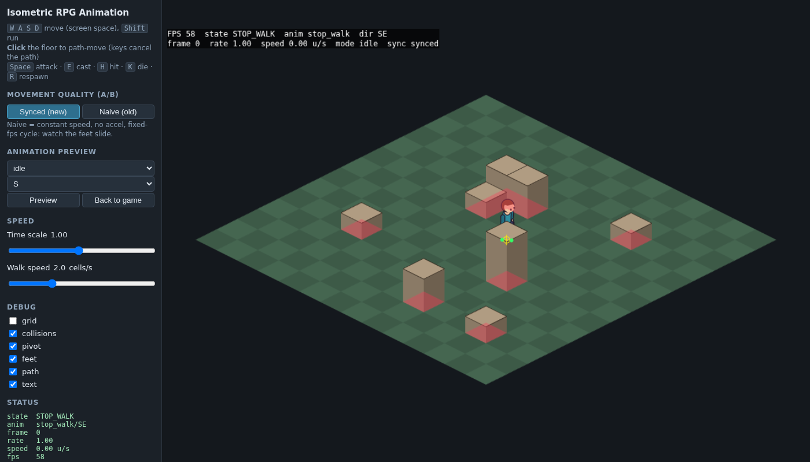
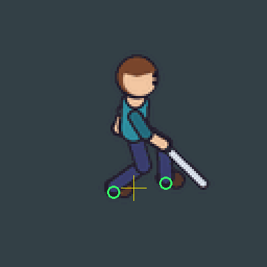
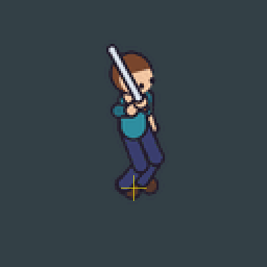

# isometric-rpg-animation

Codex Agent Skill for creating, validating and integrating natural 2D isometric character animations into Phaser.js RPG games.

It is a **working repository**, not just instructions: an engine-free TypeScript core, a Phaser 3 adapter, a Python sprite pipeline with validators, a playable demo, and tests.


 

*(Generated by this repo: the demo is a Playwright screenshot; the GIFs come from `isoanim preview --debug`, showing pivot and foot markers (green = planted, orange = swinging). The character is a procedural placeholder.)*

## The problem
Isometric RPG characters usually suffer from: feet that slide because walk speed and animation stride disagree, sprites that flicker between directions, 8-direction logic that confuses cartesian and screen directions, abrupt stops in mid-stride, pivots that jump between frames, wrong depth sorting, and movement code that cannot mix keyboard and click-to-move. This project fixes them with measurable mechanisms, and refuses to claim more than it can measure.

## Features (all implemented and tested)
| Area | What exists |
|---|---|
| Isometric maths | configurable projection (tile size, cell size, camera rotation, z), exact inverses, grid conversions, depth keys |
| Directions | screen-space 8/4 directions, hysteresis, sprite-convention remap, mirror/nearest fallback |
| State machine | priorities, interrupts, queueing, uninterruptible death, watchdog timeouts, custom states; engine-free |
| Motion | accel/decel, turn-rate arcs, collision sliding, path following, cancel/halt, mixed keyboard + click |
| Foot sync | playback rate from ground speed and stride, clamping flag, phase-preserving direction/walk↔run changes |
| Animations | idle, walk, run, start/stop walk, turn, attack, combo, cast, hit, knockback, death, spawn, victory, special + any custom key; profiles: humanoid, quadruped, flying, legless |
| Phaser 3 | asset loader with clear errors, animation registration, character controller, keyboard/pointer input, depth manager, debug overlay |
| Pipeline (Python) | split grids/gaps, background detect/remove (explicit, border-connected by default), alignment, atlas, `process` for existing sheets, `articulated` 2D rigs, `from-frames` (Blender etc.), previews, comparisons |
| Validation | atlas/manifest references, dimensions, transparency/clipping, duplicates, scale, continuity, loop seams, ground drift, cycle timing, events, foot slide, travel direction, game-speed vs stride; objective vs heuristic kept apart |
| Providers | `AnimationProvider` contract, registry, `CommandProvider` (any executable), path recommendation |

## Architecture
```
reference / sheets ─► analyze ─► production path ─► frames ─► validate ─► atlas + character-manifest.json
   (isoanim, Python)   1 sheets 2 rigs 3 Blender 4 provider                        │
                                                                                    ▼
 src/core (engine-free)  ◄── src/pipeline (manifest, atlas checks) ──► src/phaser (adapter) ──► your game
 iso · directions · state machine · movement · foot sync · registry · animation controller · depth
```
`src/core` never imports Phaser; `src/phaser` only uses the `scene` it is handed (structurally faked in unit tests, real browser in e2e).

## Quick start
```bash
git clone https://github.com/guilhermecibien/isometric-rpg-animation && cd isometric-rpg-animation
python3 -m pip install -r requirements.txt && npm install
npm run assets:demo        # regenerates assets/examples/hero (procedural, deterministic)
npm run demo               # WASD, Shift, click-to-move, Space/E/H/K/R, A/B naive vs synced
npm test && npm run test:py && npx playwright install chromium && npm run test:e2e
```

## Use with Codex
Install the folder as a skill (see [references/installation.md](references/installation.md)): symlink into `<repo>/.agents/skills/` or `~/.agents/skills/`. Then:

> Use $isometric-rpg-animation to create all animations for this character from the attached image and integrate them into my Phaser game.
>
> Use $isometric-rpg-animation to analyze my characters' current movement, find the problems and fix them while preserving the art style.

The skill makes Codex diagnose first, choose a production path, validate, and report honestly ([SKILL.md](SKILL.md)).

## CLI
```bash
python scripts/isoanim.py doctor
python scripts/isoanim.py analyze  --image ref.png --out analysis.json
python scripts/isoanim.py bg detect --image sheet.png
python scripts/isoanim.py process  --spec examples/spritesheet-spec/spec.json --out out/blocky
python scripts/isoanim.py articulated --rig examples/articulated-rig/rig.json --out out/bot
python scripts/isoanim.py validate --manifest out/blocky/character-manifest.json --report-dir out/reports --game-speed walk=1.4
python scripts/isoanim.py preview  --manifest ... --out-dir out/previews --debug
python scripts/isoanim.py compare  --before old/character-manifest.json --after new/character-manifest.json --anim walk --direction E --out cmp.png
```
Exit codes: 0 ok · 1 validation errors · 2 bad input · 3 missing tool.

## Phaser integration
See [references/phaser-integration.md](references/phaser-integration.md). Minimal:
```ts
const manifest = await new CharacterAssetLoader(this).load({ id: 'hero', manifestUrl: 'characters/hero/character-manifest.json' });
const hero = new IsometricCharacterController({ scene: this, manifest, projection, start: { x: 2.5, y: 2.5 },
  movement: { walkSpeed: 1.4, runSpeed: 3.3, acceleration: 14, deceleration: 18 }, collision, pathfinding, keyboard: true });
// update(): hero.update(time, delta)
```

## What "validated" means here
Reports separate **objective** results (sizes, hashes, references, marker arithmetic) from **heuristic** ones (statistical hints). A passing report means the data is consistent. It does **not** mean the animation looks natural; review previews and the demo. The report always says so.

## Limitations
- The demo hero is a stylized procedural placeholder (3D skeleton projected to 2D), good for verifying the pipeline, not a finished art style.
- No semantic image understanding: `analyze` is pixel statistics. Identifying hair/equipment/joints needs a vision model or a human (listed in `needsInput`).
- Blender path: `scripts/blender_render_sprites.py` is **not executed in CI** (no Blender available when written); treat as a starting point. Image-model providers are contracts only; none is bundled.
- Articulated rigs driven only by joint angles make feet swing in arcs; the validator reports the slide. Add root motion/foot-aware keys.
- Foot-slide checks need `footMarkers`; imported sheets have none unless you add them.
- Verified with Phaser 3.90 typings and headless Chromium on Linux (Node 24, Python 3.10). Windows/macOS and Phaser 4 are covered by CI configuration but not verified by the author.
- Runtime accessories (capes, weapons) follow animation frames only; no cloth/physics.
- Monster AI is out of scope by design (contracts only).

## Roadmap
Foot-marker estimation for imported sheets · IK helper for rigs · Aseprite/TexturePacker import · combo-chain authoring · Phaser 4 compatibility check · optional ffmpeg MP4 previews.

## Docs
[SKILL.md](SKILL.md) · [references/](references) · [Português](docs/pt-BR/README.md) · [CONTRIBUTING](CONTRIBUTING.md) · [CHANGELOG](CHANGELOG.md) · [THIRD_PARTY](THIRD_PARTY.md)

## License
MIT. See [LICENSE](LICENSE) and [THIRD_PARTY.md](THIRD_PARTY.md).
